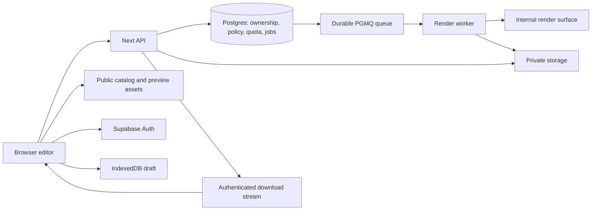

**Arsitektur teknis v1 — Mockup 3D Device**

**Keputusan terbaru 30 September 2026:** MVP memakai jalur browser saja untuk draft, screenshot, dan PNG bersih, tanpa login/kuota server atau layanan berbayar. Tabel/topologi server di bawah adalah rancangan fase pertumbuhan, belum topologi MVP. Kontrak dan langkah migrasi ada di [Dua jalur export](DUAL_EXPORT_PATH.md).

24 September 2026 · Baseline rancangan yang dipilih untuk implementasi mendatang. Belum ada aplikasi, layanan cloud, dependency terpasang, atau benchmark. Arahan terbaru: arsitektur dahulu; acuan visual ditunda dan tidak menghalangi proof teknis.

Status dan urutan delapan tahap: [Project status](</Users/aleph/Documents/ChatGPT/3D Builder - XXX/PROJECT_STATUS.md>). Detail data/API: [System contracts](</Users/aleph/Documents/ChatGPT/3D Builder - XXX/docs/architecture/SYSTEM_CONTRACTS.md>). Struktur kode: [Repository blueprint](</Users/aleph/Documents/ChatGPT/3D Builder - XXX/docs/architecture/REPOSITORY_BLUEPRINT.md>). Backlog: [Implementation roadmap](</Users/aleph/Documents/ChatGPT/3D Builder - XXX/docs/architecture/IMPLEMENTATION_ROADMAP.md>).

**Keputusan dasar**

| Area | Baseline pilihan | Alasan dan batas |
|---|---|---|
| Workspace | TypeScript + pnpm workspace | Satu repositori untuk web, worker, kontrak, dan renderer bersama; versi dependency dipin saat scaffold |
| Web dan API | Next.js App Router; API pada runtime Node | Editor dan endpoint satu origin; satu backend aplikasi untuk awal |
| 3D | Three.js + React Three Fiber; WebGL sebagai baseline awal | Scene bersama untuk preview dan render final; WebGPU bukan dependency rilis awal |
| State editor | State lokal React; IndexedDB untuk draft/blob | Perubahan UI tidak mencampur objek GPU dengan data project |
| Kontrak runtime | Schema TypeScript dengan validasi runtime, usulan Zod | Browser, API, dan worker sepakat format; validasi server tetap wajib |
| Akun | Supabase Auth | Baseline managed auth; Google + email link sebagai opsi flow, konfigurasi produksi di tahap 5 |
| Database | Supabase Postgres | Relasi, ownership, policy, job, serta transaksi kuota dalam satu database |
| Storage | Supabase Storage | Bucket preview publik terpisah dari upload, full model, dan output privat |
| Queue | PGMQ / Supabase Queues, durable logged queue | Job dan reservasi kuota dapat dibuat bersama enqueue dalam transaksi Postgres |
| Renderer server | Node worker + Playwright/Chromium + render surface internal | Pekerjaan berat berjalan terpisah dari request API; memakai scene renderer yang sama |
| Billing | Adapter untuk payment provider, belum diaktifkan | Free entitlement tersedia dulu; provider/harga dipilih sebelum fase Pro |
| Pengujian | Unit kontrak/domain, integrasi Postgres/queue, alur browser | Fokus crop/timing, akses, race kuota, recovery, dan hasil PNG |

Next.js mendukung Route Handlers dan deployment Node/container, sehingga app/API tidak perlu terikat pada satu host. Supabase menyediakan auth berbasis session, Postgres, serta storage bucket publik/privat. PGMQ menyediakan queue dengan visibility timeout. Pilihan penggabungan komponen di atas adalah rancangan proyek ini. [Next Route Handlers](https://nextjs.org/docs/app/getting-started/route-handlers), [Next self-hosting](https://nextjs.org/docs/app/guides/self-hosting), [Supabase Auth SSR](https://supabase.com/docs/guides/auth/server-side), [Storage buckets](https://supabase.com/docs/guides/storage/buckets/fundamentals), [PGMQ](https://supabase.com/docs/guides/queues/pgmq).

**Topologi fase backend terkelola**

Upload memakai grant sempit yang diterbitkan API untuk object/path milik user; browser dapat mengirim file langsung ke storage tanpa menjadikan bucket publik. Setelah upload, server memvalidasi file sebelum boleh dipakai job. Diagram menampilkan komponen utama, bukan semua request.

Dua jenis compute yang dideploy: web/API dan worker. Render surface merupakan bundle browser internal yang disajikan worker di loopback; bukan website publik ketiga. Worker membaca queue menggunakan kredensial backend, mengolah satu job, lalu membuat artifact privat. Browser tidak dapat mengirim instruksi langsung ke worker atau queue.

**Batas modul dan kepercayaan**

- UI menerbitkan command dan menampilkan status; tidak menentukan hak export, harga, atau sisa kuota.
- Scene domain menyimpan data berseri dan perhitungan pose berdasarkan waktu; tidak mengetahui session, database, atau komponen panel.
- Renderer mengubah scene menjadi pixel; menerima resolver asset sesuai lingkungan. Renderer browser memakai preview; worker memakai full asset privat.
- API memverifikasi session, user aktif, ownership, batas schema/scene, policy, serta kuota. Actor diambil dari session yang diverifikasi, bukan request body.
- Database menjadi sumber status job dan konsumsi kuota. Status yang tampil di client tidak dapat menjadi bukti job berhasil atau user Pro.
- Worker hanya menerima job ID/version dan membaca snapshot tervalidasi. URL, HTML, shader, script, atau file path arbitrer dari user tidak menjadi input render.

Rancangan memakai auth-token verification pada server melalui metode SDK yang memverifikasi signature/claims; jangan mempercayai isi session cookie dari pembacaan lokal saja. Pemeriksaan account status aplikasi dilakukan untuk operasi sensitif. SDK session refresh tidak menggantikan authorization per resource. [Supabase server client guidance](https://supabase.com/docs/guides/auth/server-side/creating-a-client?framework=nextjs).

**Database, akses, dan transaksi**

Domain tables ditempatkan pada schema privat yang tidak diekspos langsung melalui Data API untuk browser. API memakai role backend terbatas untuk menjalankan operasi domain; worker memakai role terpisah untuk claim/heartbeat/finalize. Queue tidak diekspos kepada anonymous/authenticated browser role. RLS/grant melindungi tabel/bucket yang dapat dicapai dari role client; kunci server tidak pernah masuk bundle publik. [Supabase RLS](https://supabase.com/docs/guides/database/postgres/row-level-security), [Queue exposure controls](https://supabase.com/docs/guides/queues/quickstart).

SQL migration menjadi sumber definisi database, constraint, grant, dan fungsi transaksi. Hindari dua sumber migration yang saling bersaing. Operasi create-export mengunci row quota period, memeriksa kapasitas, membuat reservation/job dan enqueue PGMQ dalam satu transaksi. Jika transaksi gagal, tidak ada job yang tertinggal tanpa reservation atau sebaliknya. Billing/schema tambahan baru dibuat saat dibutuhkan, tetapi policy Free sudah bekerja sejak tahap 5.

Pada verified login pertama, API membuat account dan default Free entitlement secara idempotent; akun/entitlement yang sudah ada tidak direset oleh login berikutnya. Email delivery dan OAuth credentials disiapkan pada tahap 5, tanpa menaruh secret pada repo. Upload dibatasi per akun dan total storage agar validasi gratis tidak menjadi antrean render tanpa batas.

Pemanggilan fungsi privileged hanya dilakukan role API/worker; jangan memberi execute kepada browser role. Fungsi privileged menggunakan search path tetap dan operasi terbatas. Parameter owner pada operasi backend berasal dari identitas yang sudah diverifikasi API. Migration harus menguji grants selain menguji query yang berhasil.

**Alur guest, login, dan export**

1. Guest mengedit memakai file lokal dan preview asset. Draft menyimpan seluruh gambar serta scene ke IndexedDB. Belum ada cloud project library.
2. Klik Export membekukan snapshot/playhead dan menyimpan intent. User yang belum masuk mengikuti login; callback memulihkan draft yang sama, termasuk duo.
3. API memberikan grant upload terbatas. Server memeriksa byte/dimensi/format hasil decode dan membentuk asset canonical yang dipakai preview sebelum export serta worker. Bila normalisasi mengubah tampilan, preview diperbarui sebelum export diteruskan.
4. API memeriksa policy, scene, semua asset/instance, lalu membuat job dengan idempotency key, reservation, dan queue message secara atomik.
5. Worker merender menggunakan snapshot, policy, asset version, dan renderer release yang dikunci untuk job. File hasil ditempatkan pada object privat untuk attempt tersebut.
6. Finalisasi memeriksa bahwa attempt/lease masih berlaku; artifact metadata, status success, dan quota consumption di-commit bersama. Setelah itu queue di-ack/archive.
7. Browser mengambil status dan mengunduh melalui gateway terautentikasi. Re-download artifact valid tidak menghasilkan pemakaian baru.

Validasi gambar berjalan sebagai task worker pada queue durable tersendiri: upload complete → asset validation task → decode/normalisasi terbatas → ready/rejected. Complete yang diulang tidak menduplikasi task. API tidak menahan request sampai proses decode/render panjang selesai. Input invalid tidak mengonsumsi quota PNG, tetapi tetap terkena rate/storage limits. Queue validation dan queue render mempunyai batas resource dan retry masing-masing.

Cookie-auth API yang mengubah data memeriksa origin dan proteksi CSRF. OAuth menggunakan flow/state/PKCE dan allowlist redirect provider yang sesuai. Session/status/download tidak di-cache secara publik. Mekanisme persis disesuaikan dengan versi SDK yang dipin dan diuji saat implementasi.

**Queue, retry, dan kondisi balapan**

Desain consumer memperlakukan delivery sebagai dapat terulang: visibility timeout yang kedaluwarsa dapat menyebabkan message diproses lagi. Jaminan bisnis berasal dari idempotency, lease, constraint unik, dan finalisasi atomik; bukan klaim exactly-once untuk seluruh render. Dokumentasi PGMQ menjelaskan bahwa message terlihat kembali setelah visibility timeout. [PGMQ read behavior](https://supabase.com/docs/guides/queues/pgmq).

Worker memakai read dengan visibility, bukan pop yang langsung menghapus message. Claim menaikkan attempt/fencing token di database; heartbeat memperpanjang lease serta visibility. Worker lama tidak boleh commit hasil setelah lease berpindah. Retry hanya untuk error sementara; asset/schema salah menjadi failure yang jelas. Batas attempts, timeout, dan backoff berupa konfigurasi server, ditentukan saat proof.

Cancel dicatat di database. Sebelum finalisasi, worker memeriksa cancel dan fencing token di transaksi yang sama dengan commit success. Jika cancel menang, reservation dilepas dan object hasil sementara dibersihkan; jika success sudah menang, cancel tidak mengubah konsumsi yang sah. Reconciler mengatasi lease kedaluwarsa, worker mati, reservation macet, serta artifact orphan.

**Renderer yang konsisten**

Web editor dan render surface menggunakan paket komponen scene yang sama, dengan camera, crop, lighting, dan evaluator motion bersama. Preview menyesuaikan pixel density; worker memakai dimensi output eksplisit. Perhitungan motion memakai waktu absolut, bukan akumulasi delta yang bergantung kecepatan laptop. R3F menyediakan manual frame advancement; render surface menggunakan mode yang dikendalikan setelah scene/material/texture siap. [R3F hooks](https://r3f.docs.pmnd.rs/api/hooks).

Readiness meliputi asset selesai load/decode, perubahan scene terpasang, shader/resource siap, dan frame final selesai. Jangan memakai fixed sleep sebagai bukti render siap. PNG berasal dari canvas/render target scene, tanpa panel editor, selection gizmo, atau background CSS yang terlewat. Perbedaan proxy dan full asset boleh pada detail, tidak pada screen mapping atau framing.

Environment worker mengunci versi browser, renderer, asset, color pipeline, dan preset lighting. Pixel lintas GPU tetap bisa berbeda; QA memakai toleransi dan pemeriksaan komposisi/warna. Private model tidak dimasukkan ke build browser. Preview watermark dan proxy tetap bisa dimodifikasi oleh client teknis; file export resmi dilindungi server, bukan jaminan anti-screenshot.

**Deployment dan environment**

| Environment | Rencana |
|---|---|
| Local v0, tahap 3 | Web editor + local fixture resolver; export proof lokal saja; tanpa akun/cloud yang wajib |
| Local backend, tahap 5 | Postgres/PGMQ dan storage/auth dev, API, worker; fixture akun tanpa data produksi |
| Staging | Akun/storage/database terpisah, worker versi tetap, catalog subset; beta privat |
| Production | Web/API Node, managed Supabase, worker container pada compute yang lolos benchmark, CDN preview |

Supabase menjadi baseline auth/database/storage. Host web dan worker tidak dikunci ke paket komersial sekarang: requirement-nya adalah Node/container untuk web dan worker persisten yang mendukung Chromium/WebGL dengan batas resource yang terukur. Jalur GPU atau software rendering dipilih setelah benchmark tahap 4/5; gambar Docker saja tidak membuktikan GPU tersedia atau render murah.

Worker menggunakan image produksi yang dipin, user non-root, browser sandbox yang sesuai, limit CPU/memori/waktu, dan isolasi job. Browser hanya membuka render surface internal; akses network dibatasi ke resource yang disiapkan resolver, bukan internet arbitrer. Playwright mendokumentasikan pentingnya versi yang cocok serta konsekuensi root terhadap sandbox. [Playwright Docker](https://playwright.dev/docs/docker).

Mulai dengan concurrency worker satu job per slot render; naikkan setelah pengukuran. Gunakan deployment terkoordinasi: rendererRelease dipilih server dan queue diberi versi release. Worker lama menyelesaikan queue lama sebelum dihentikan; versi asset/job tidak diganti diam-diam saat deploy. Perubahan database memakai expand/migrate/contract agar web dan worker yang sedang drain tetap kompatibel.

**File dan lifecycle**

Bucket terpisah: preview-assets publik, source-uploads privat, normalized-inputs privat, render-assets privat, dan exports privat. Metadata tidak mengekspos private key/credential. Asset diidentifikasi lewat ID/version, bukan URL input user.

Usulan lifecycle awal mengikuti product plan: input upload dihapus 24 jam setelah job terminal jika tidak dipakai job lain, output 7 hari; angkanya belum menjadi janji publik. Upload terbengkalai dan object attempt orphan ikut dibersihkan. Pending/running/retry job menahan referensi asset yang dibutuhkan. Local draft dan cloud export punya lifecycle berbeda dan dijelaskan ke user.

Download default melalui session/ownership gateway dengan streaming, bukan load seluruh file ke memori. Signed URL singkat dapat menjadi optimasi kelak dengan pengakuan bahwa bearer link dapat dibagikan selama berlaku. Setelah user sah menerima PNG, file itu dapat disalin.

**Operasional, biaya, dan validasi**

Catat correlation ID lintas request/job/attempt, antrean, render/encode duration, peak memory, failure reason, retry count, bytes output/egress, serta jumlah export sukses per akun. Jangan mencatat pixel screenshot, token, signed URL, atau isi scene lengkap pada log umum. Metric penting: completion rate, p95 antrean/render, biaya per PNG/video, dan login-to-export conversion.

Sebelum publik: uji restore backup, cleanup/lifecycle, worker kill/retry, cancel race, quota contention, download ownership, serta kebocoran full asset dalam bundle. Gunakan alert pada queue lag, worker heartbeat hilang, dan failure/biaya melonjak. Provider billing masuk tahap 8 dengan verified webhook, dedup, rekonsiliasi, dan allowance berbasis pemakaian; checkout tidak dibuka sebelum fitur berbayar siap.

**Keputusan yang sengaja menunggu pengujian**

GPU/CPU host worker dan anggarannya; angka quota Free serta resolusi publik; target waktu export; daftar final 10 model; TTL publik; provider billing dan harga; standar visual akhir. Semua ini mempunyai milestone keputusan pada roadmap. Ketidakpastian tersebut tidak menghalangi penyusunan kontrak atau proof v0 lokal.
